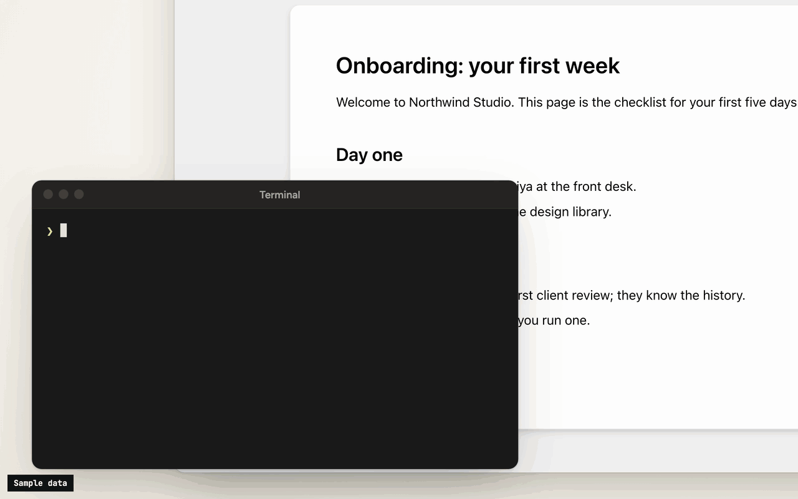
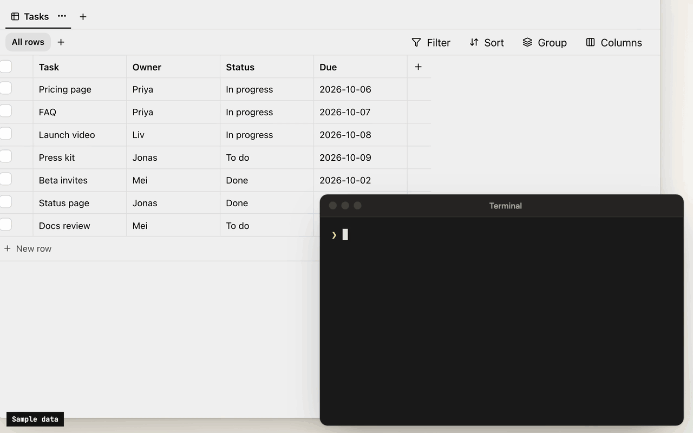
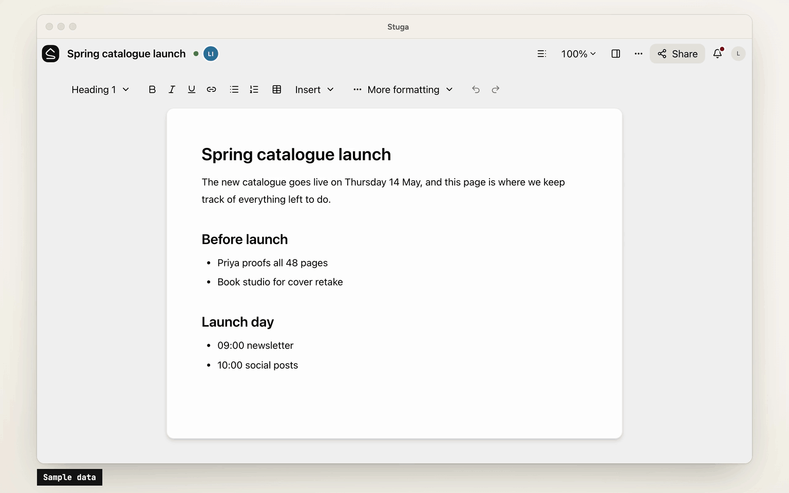

# Stuga

**Your AI writes the team wiki. A colleague approves.**

A team wiki of pages and tables, on a Mac or server you run. Say **Save to Stuga** to Claude, Codex
or any MCP client, and it files each point on the right page or in the right table row. By default
a change to the wiki waits for whoever asked the AI; set a folder to **Reviewed by a colleague** and
someone else approves it. **Ask Stuga** answers from what is approved, and says what still waits.

[Download for Mac](https://stuga.dev/download/mac) (Apple silicon, macOS 15+) ·
[Install with Docker](docs/install/docker.md)

Install, then [create your account and workspace](https://stuga.dev/docs/install/create-your-account-and-first-workspace)
and [connect your AI](docs/agents.md). Help for people using Stuga: [stuga.dev/docs](https://stuga.dev/docs).



## How the wiki stays right

- **Save to Stuga.** Your AI finds the page and section a point belongs in, or the row a fact fills,
  and corrects the sentence it changes rather than adding another. It cites the meeting or email a
  point came from, and tells you what it saved where and what waits. A point no page is about starts
  a page in the folder it belongs in, or goes in your own **My notes**.
- **Three review levels.** In **Who reviews AI edits…**, a folder, page or database is **Reviewed by
  whoever asked the AI** (the default), **Reviewed by a colleague** (someone else who can edit it,
  from the folder's approver group if it names one, never the person who asked), or **AI edits apply
  directly** (recorded, attributed and revertible).
  People's own edits go straight in.
- **One card per change.** Filing a meeting across several pages is one change, reviewed on one card
  laid out for a phone: each edit in its paragraph, with the sources it cites. **Approve all**,
  **Ask for changes…** or **Decline…** with a note the AI reads. A folder can post each change that
  waits for a colleague to a Slack channel.
- **Ask Stuga.** Your AI answers from the pages and tables, with who last changed each one and when,
  and what waits: "the page says 14 days; a change to 30 days waits for a colleague".
- **Check Stuga.** **Linked from** under each page, **Needs checking** when a page it cites changes,
  and **Wiki → Index** and **Wiki → Log**. Say **Check Stuga** and your AI finds stale pages,
  orphans and broken links, and proposes the fixes as one change.
- **Instructions that stack.** The workspace, folders, pages and databases can each tell agents what
  goes where. They advise the model; permissions and review decide what a write does.



## What's in it

- **Pages written together.** Real-time editing (Tiptap over a Yjs CRDT) with presence, comments,
  @mentions and version history.
- **Tables beside the pages.** Typed tables, each database its own SQLite file, with saved views,
  row pages and CSV import. Agents, Ask and the REST API run read-only SQL on them.
- **Search that follows permissions.** Keyword (BM25 over Postgres full-text search) and semantic
  (pgvector) search in one SQL statement, with access checked inside it. Chinese, Japanese, Korean
  and Thai work without setup.
- **Built-in AI, off until set up.** A co-author and a table assistant, whose edits are reviewed like
  an agent's, and **Ask**, which cites sources. OpenAI, Anthropic, Gemini, DeepSeek and more, or Ollama.
- **Sharing and sign-in.** Workspaces, folders, per-page sharing, groups and guests. People join
  by invite link and sign in with a password or your OpenID Connect provider.
- **Import and export.** A Notion export, or a zipped Obsidian vault or folder of Markdown, becomes a
  workspace; a workspace exports as one `.stuga.zip` of Markdown, JSON Lines and its files.



## Connect your AI

Agents connect over MCP. **Settings → Your AI agents** gives the setup for Claude Code,
Claude Desktop, Codex, Antigravity, Cursor, VS Code, Kiro, Goose, LM Studio, DeepSeek Harness and Pi,
with your node's address filled in, and the URL any other MCP client needs
([docs/agents.md](docs/agents.md)). Each agent brings its own model, so the node needs no AI key.

- **Scoped sign-in.** Most clients sign in through the browser, where you tick the workspaces an app
  may use and choose **Read only** or **Read and suggest changes**. **Revoke** ends its access.
- **Narrow keys.** A client without sign-in uses an API key, which can be confined to folders, made
  read-only or given an expiry.
- **Content only.** Agents change documents and databases. Renaming, moving, deleting, sharing and
  the review setting stay with people.
- **Full audit.** Every MCP call, reads included, is in the workspace's audit log. An event feed
  and signed webhooks report what changed.

## Your data

Stuga sends no telemetry, and nothing reaches us unless a node admin turns on
[remote access](docs/remote-access.md). The node makes outbound requests only for features in use,
such as an AI provider, and asks GitHub once a day for the list of releases unless a node admin
turns that off. [docs/privacy.md](docs/privacy.md) lists what the node sends and stores.

## Install

- **A Mac with Apple silicon**, on macOS 15 or later: open
  [the package](https://stuga.dev/download/mac), or `Stuga-<version>.pkg` from the
  [latest release](https://github.com/stuga-dev/stuga/releases/latest). It carries its own
  Postgres and Node.js ([docs/install/macos.md](docs/install/macos.md)).
- **Docker** on x86-64 or arm64, such as a Linux server or a NAS: `install.sh` starts Postgres
  and the node with Compose ([docs/install/docker.md](docs/install/docker.md)):

  ```sh
  curl -fsSL https://github.com/stuga-dev/stuga/releases/latest/download/install.sh | bash
  ```

A node is one Node.js process and Postgres with pgvector; people open it in a browser.
It backs itself up every day by default and before every upgrade
([docs/operations.md](docs/operations.md)). [docs/getting-started.md](docs/getting-started.md) walks
through the first hour.

## Questions and feedback

Ask a question or share an idea in [Discussions](https://github.com/stuga-dev/stuga/discussions);
report a bug as an [issue](https://github.com/stuga-dev/stuga/issues/new?template=bug.md).

## Contributing

Issues and pull requests are welcome. [CONTRIBUTING.md](CONTRIBUTING.md) covers running Stuga from
source, the tests and the conventions, and [RELEASING.md](RELEASING.md) how a release is cut.
Contributions are accepted under a Contributor License Agreement ([CLA.md](CLA.md)); a bot asks on
your first pull request. Report a vulnerability privately, as [SECURITY.md](SECURITY.md) describes.

## License

[AGPL-3.0-only](LICENSE), except [integrations/](integrations/), which is [MIT](integrations/LICENSE);
copyright notice in [NOTICE](NOTICE). If you modify Stuga and offer it to others over a network, you
share your changes under the same terms. The name and logo are not covered by the license:
[TRADEMARKS.md](TRADEMARKS.md) says how you may use them.
